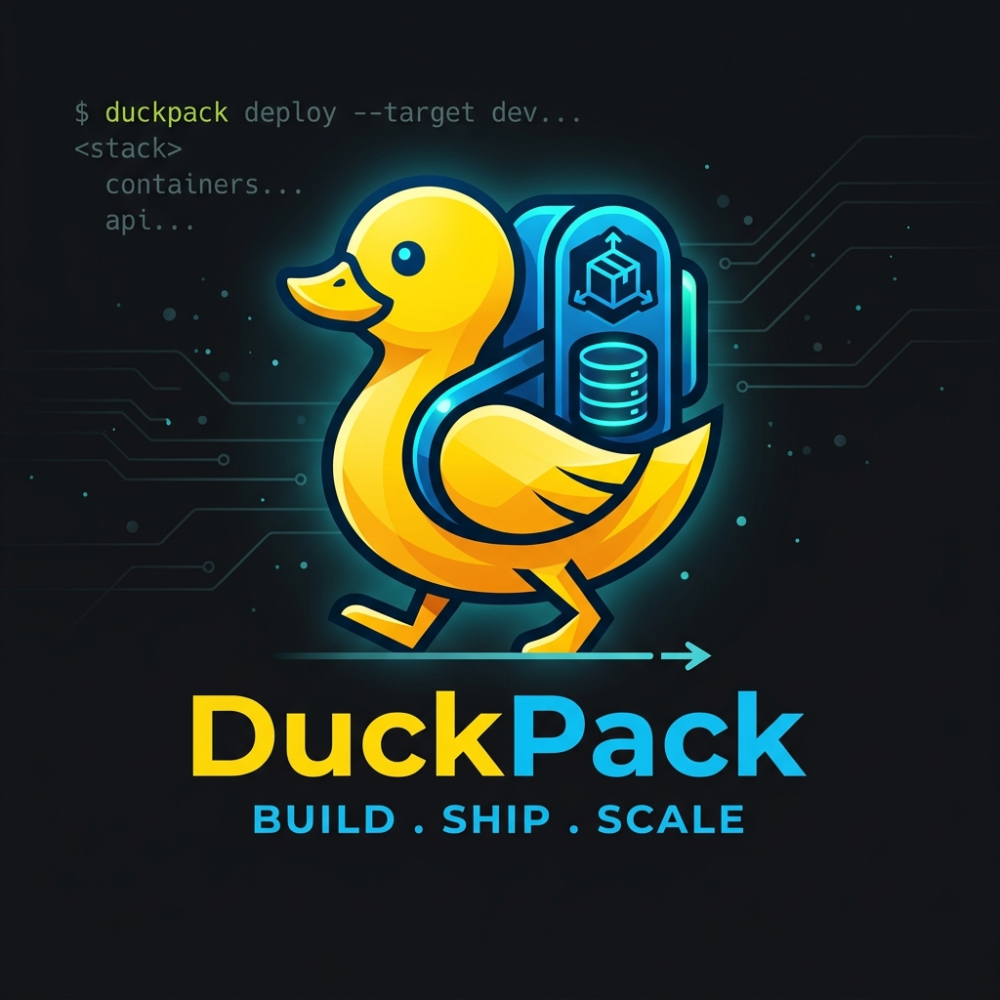

<p align="center">
  
</p>

<p align="center">
  <strong>Declarative Schema Management, Interactive Terminal IDE, and In-Memory Inspection for DuckDB v2.0</strong>
</p>

<p align="center">
  <a href="https://github.com/Benjas86/duckpack/releases"></a>
  <a href="https://pypi.org/project/duckpack/"></a>
  <a href="https://pypi.org/project/duckpack/"></a>
  <a href="https://crates.io/crates/duckpack"></a>
  <a href="https://github.com/Benjas86/duckpack/blob/main/LICENSE"></a>
</p>

---

DuckPack brings the **SQL Server Data Tools (SSDT)** paradigm to **DuckDB** and **DuckLake**. Instead of maintaining fragile numbered `UP`/`DOWN` migration scripts, you declare your desired database state as plain `.sql` files in Git — DuckPack compiles them against an in-memory Shadow DB, detects renames heuristically, and applies safe, transactional migrations.

It ships as a **standalone native binary** and a **Python package** (`pip` / `uv`) with a built-in **Terminal IDE**, multi-catalog workspace orchestration, DuckLake time travel, declarative Quack RBAC, and live Jupyter/Python in-memory debugging.

---

## Quick Start

### Install

```bash
# Python (installs both `import duckpack` and the `duckpack` CLI binary)
uv add duckpack          # or: pip install duckpack

# Rust / Cargo
cargo install duckpack

# Standalone binary (Linux x86_64 — macOS, ARM64, musl & Windows on GitHub Releases)
curl -L https://github.com/Benjas86/duckpack/releases/latest/download/duckpack-linux-amd64 -o duckpack \
  && chmod +x duckpack && sudo mv duckpack /usr/local/bin/
```

### 60-Second CLI Workflow

```bash
duckpack init --project-dir my_warehouse && cd my_warehouse
# Add desired-state SQL files under schemas/, sequences/, tables/, views/, macros/, triggers/
duckpack build                           # Validate syntax & dependencies offline in Shadow DB
duckpack diff --db warehouse.duckdb      # Preview structural drift
duckpack apply --db warehouse.duckdb     # Interactive visual diff review & safe apply
duckpack explore --db warehouse.duckdb   # Launch the built-in Terminal IDE
```

### 60-Second Python & Notebook Workflow

```python
import duckdb
import duckpack

con = duckdb.connect()
duckpack.apply(con, project_dir="./my_warehouse", auto_approve=True)  # Great for pytest & ETL
duckpack.explore(con)  # Opens live Terminal IDE (auto-spawns terminal window in Jupyter/VS Code)
```

---

## Feature Highlights

- **Declarative Schema Management:** Plain `.sql` definitions for nested schemas, sequences, scalar & table macros, tables, `SECURE VIEW`s, `VARIANT` columns, and DuckDB v2.0 triggers compiled in topological order.
- **Smart Non-Destructive Diffs:** Jaro-Winkler heuristic rename detection, in-place `ADD PRIMARY KEY` / `UNIQUE`, atomic copy-and-swap (`__duckpack_swap`) with automatic trigger preservation, and `.duckpackignore` / `.env` `${VAR}` templating.
- **Built-in Terminal IDE (`duckpack explore`):** Dual-mode Explorer (`F3: Live DB` vs. `F4: Project Authoring`), syntax highlighting, `Ctrl+Space` autocomplete, `F2` per-tab database switching, PK/FK badges (`🔑`, `🔗`), Mermaid.js ERD export (`Ctrl+G`), and CSV export (`Ctrl+O`).
- **Declarative Multi-Catalog Workspaces (`duckpack.toml`):** Define `[[secrets]]` (strict `*_env` hygiene) and `[[attach]]` (multi-container DuckLake, Quack, MSSQL, PostgreSQL, MySQL, SQLite, MotherDuck) with clean in-memory Workspace Mode, resilient offline placeholders, and `Ctrl+S` TUI persistence.
- **First-Class DuckLake Lakehouses:** Supports DuckDB File, PostgreSQL, SQLite, Quack, and remote frozen (`https://`/`s3://`) catalogs, `--allow-lake-rewrite` Parquet rewrite guard, automatic `set_commit_message` tagging, `📸 Snapshots` explorer, and interactive Time-Travel (`t`).
- **Quack Remote Servers & Declarative RBAC (`Ctrl+U`):** Federated local+remote joins, `[quack_auth]` roles (`admin`/`writer`/`reader`) with SHA-256 tokens, DuckLake-aware `ducklake_mode`, zero-secret portable `.duckpack` RBAC bundles (`compile --rbac-only` / `apply --from`), live session cancel/revoke/override, and `--rbac-only` container restart hooks.
- **Python, Pytest & Jupyter Parity:** Seamless `explore(con)`, `apply(con)`, `diff(con)`, `compile()`, and `SessionBridge` two-way temporary table synchronization.
- **CI/CD Ready:** Offline Shadow DB `build`, immutable `.duckpack` snapshot artifacts (`compile`), dry-run SQL output (`--out`), `--auto-approve`, and SSH `deploy` / `explore --remote`.

---

## Terminal IDE Preview

```text
┌ Explorer (25%) [W: Width | +/-: Resize | R: Refresh | q: Query] ──┬─ [Tab 1: cross_join.sql] ── [+ New] ── [❌ Close] ────┐
│ ▼ 📁 target_db [Active] (quack)                                    │ SELECT                                                │
│   ▼ 📦 Tables (2)                                                  │   ro.order_id,                                        │
│     ├─ customers (1,450 rows)                                      │   ro.amount,                                          │
│     │  ├─ 🔑 customer_id (BIGINT) [PK]                             │   lu.user_email                                       │
│     │  └─ email (VARCHAR)                                          │ FROM target_db.orders ro                              │
│     └─ orders (8,920 rows)                                         │ JOIN memory.local_users lu                            │
│        ├─ 🔑 order_id (BIGINT) [PK]                                │   ON ro.customer_id = lu.id                           │
│        └─ 🔗 customer_id (BIGINT) [FK -> cust...]                  │ LIMIT 100;                                            │
│ ▼ 🌊 sales_lake (ducklake)                                         │                                                       │
│   ├─ 📦 Tables (4)                                                 │                                                       │
│   └─ 📸 Snapshots (15)  [t: Time Travel]                           │                                                       │
├────────────────────────────────────────────────────────────────────┴───────────────────────────────────────────────────────┤
│ Query Results [Page 1/1] (Showing 50 rows)                                                                                 │
│ order_id │ amount  │ user_email                                                                                            │
│ 1001     │ 149.99  │ alice@example.com                                                                                     │
│ 1002     │ 89.50   │ bob@example.com                                                                                       │
└────────────────────────────────────────────────────────────────────────────────────────────────────────────────────────────┘
```

---

## Documentation

Full guides, configuration references, keyboard shortcuts, and copy-pasteable recipes live in **[`docs/`](https://github.com/Benjas86/duckpack/blob/main/docs/index.md)**:

| Guide | Topics Covered |
| :--- | :--- |
| **[Getting Started](https://github.com/Benjas86/duckpack/blob/main/docs/getting-started.md)** | Binary, `pip`/`uv`, and Cargo installs + 5-minute CLI & Python walkthrough |
| **[Declarative Projects & Authoring](https://github.com/Benjas86/duckpack/blob/main/docs/declarative-projects.md)** | Project layout, DuckDB v2.0 features, sequences, triggers, constraint diffing, `.env` templating, `.duckpackignore` |
| **[Terminal IDE Guide](https://github.com/Benjas86/duckpack/blob/main/docs/terminal-ide.md)** | Full Keyboard Shortcuts Cheat Sheet, `F3`/`F4` dual mode, `F2` tab switcher, `Ctrl+A`, `Ctrl+K`, `Ctrl+G`, resizing & mouse |
| **[Workspace & Configuration](https://github.com/Benjas86/duckpack/blob/main/docs/workspace-and-configuration.md)** | `duckpack.toml` reference, `--env` profiles, `[[secrets]]` hygiene, multi-catalog `[[attach]]`, Workspace Mode |
| **[DuckLake Lakehouse Guide](https://github.com/Benjas86/duckpack/blob/main/docs/ducklake.md)** | Connection Triad, remote/frozen URLs, `--allow-lake-rewrite`, `set_commit_message`, Snapshots & Time-Travel Modal (`t`) |
| **[Quack Remote Server & RBAC](https://github.com/Benjas86/duckpack/blob/main/docs/quack-and-rbac.md)** | Dual-catalog sessions, `-- @remote`, `[quack_auth]` RBAC, `Ctrl+U` Session Monitor, `--rbac-only` Docker/K8s/systemd hooks |
| **[External Databases & Cloud Storage](https://github.com/Benjas86/duckpack/blob/main/docs/external-databases.md)** | MSSQL (native TDS, Windows Auth/Kerberos, named instances), PostgreSQL, MySQL, SQLite, MotherDuck, S3/R2/GCS/Azure |
| **[Python & Notebook Integration](https://github.com/Benjas86/duckpack/blob/main/docs/python-and-notebooks.md)** | In-memory `explore(con)`, Jupyter/VS Code pop-outs, `SessionBridge`, Pytest `apply`, drift `diff`, full Python API reference |
| **[CI/CD & Production Deployment](https://github.com/Benjas86/duckpack/blob/main/docs/cicd-and-deployment.md)** | Immutable `.duckpack` snapshots (`compile`), `--auto-approve`, `--out` dry runs, SSH `deploy`, GitHub Actions workflow |
| **[CLI Reference](https://github.com/Benjas86/duckpack/blob/main/docs/cli-reference.md)** | Every `duckpack` subcommand, flag, default value, environment variable, and version diagnostic |
| **[Architecture: How DuckPack Works](https://github.com/Benjas86/duckpack/blob/main/docs/architecture.md)** | Shadow DB compilation, `DbExecutor` seam, atomic copy-and-swap, Quack isolation, and `SessionBridge` |

---

## NOTE

I've spent time as an educational journey into Rust vibe coding this application. I have personal reasons to want to use this application and had never tried to 'vibe code' anything before.

I know this may contain 'sub-optimal' or 'vibe code' solutions and code that could be written more elegantly. I've also not fully tested everything yet so expect bugs, I'm fine with this! If you find this useful, want to tinker etc, please do.

Thanks,  
**Ben**
