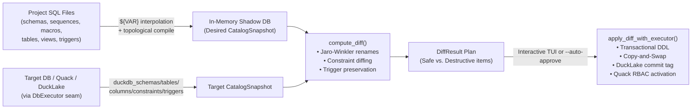
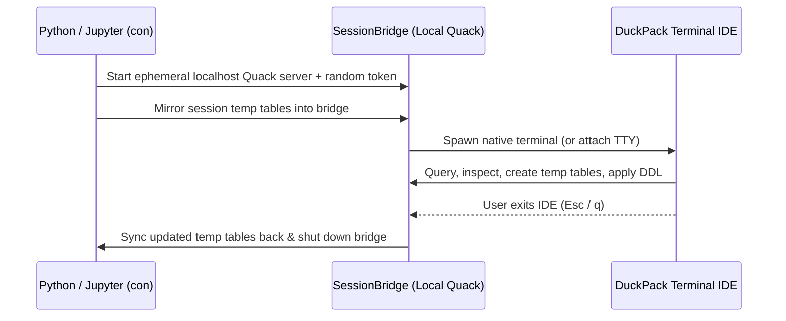

[← Docs Index](./index.md)

# Architecture: How DuckPack Works

This page gives a concise technical overview of DuckPack's internal pipeline — useful for understanding why migrations behave the way they do, how remote/Python sessions stay isolated, and where engine boundaries sit.

---

## 1. Declarative Diff & Apply Pipeline

DuckPack never relies on regex-parsing your SQL files to guess schema changes. Instead, it delegates SQL parsing and semantic resolution directly to an embedded DuckDB v2.0 **Shadow Database**:

### Why Shadow DB Compilation Matters
- **100% DuckDB Parser Fidelity:** Any valid DuckDB v2.0 DDL (`VARIANT`, nested schemas, `CREATE SECURE VIEW`, `table_macro`, generated columns, triggers, sequences) is validated by DuckDB's own binder before diffing.
- **Sandboxed Execution:** `build_shadow_db` locks configuration (`enable_external_access = false`, `allow_community_extensions = false`, `lock_configuration = true`) and mounts `.duckpack` artifacts read-only so compiling untrusted SQL cannot exfiltrate local files or make network calls.
- **Zero Drift Noise:** Comparing two introspected `CatalogSnapshot` structs normalizes formatting, whitespace, and runtime sequence `START` counter advancement automatically.
- **Unified `DbExecutor` Seam:** Both local `duckdb::Connection` instances and Python/remote adapters execute through one `DbExecutor` trait, keeping CLI, TUI, and Python behavior identical.

---

## 2. Atomic Copy-and-Swap & Dependency Ordering

When a table change cannot be expressed as an in-place `ALTER TABLE` (such as adding `FOREIGN KEY`/`CHECK` or dropping a constraint):
1. DuckPack builds a single `BEGIN TRANSACTION; ... COMMIT;` swap script creating `<table_name>__duckpack_swap`.
2. Common non-generated columns (`!is_generated`) are copied via `INSERT INTO ... SELECT ...`.
3. The original table is dropped and the staging table is renamed to the unqualified leaf table name inside the same schema.
4. Any triggers previously attached to that table are automatically re-emitted immediately after the swap.
5. On DuckLake targets, `CALL "<lake>".set_commit_message(...)` is injected inside the transaction before `COMMIT;`, and the entire rewrite is blocked unless `--allow-lake-rewrite` is explicitly enabled.

---

## 3. Dual-Catalog Quack & Multi-Container Isolation

- **Per-Alias Credential Isolation:** Rather than relying on a single global `TYPE QUACK` secret, DuckPack binds credentials per endpoint/alias (`ATTACH ... (TOKEN ..., CLIENT_ID ...)` for direct Quack, and DuckLake's native typed `META_TOKEN`, `META_CLIENT_ID`, and `META_DISABLE_SSL` parameters for DuckLake-on-Quack). This allows mounting multiple independent Quack / DuckLake containers — or multiple RBAC roles (`admin` + `writer` + `reader`) against the same server — inside one session without credentials colliding.
- **In-Place Cache Invalidation:** Refreshing a Quack catalog invokes DuckDB v2.0's `CALL quack_clear_cache();` so remote schema updates appear without detaching `target_db` or dropping active credentials.
- **Safe RBAC Activation Order:** During `apply`, `_duckpack_auth` tables and hardened authorization macros are committed **before** `SET GLOBAL quack_authentication_function` and `SET GLOBAL quack_authorization_function` are enabled, preventing half-committed lockout states.

---

## 4. Python `SessionBridge` & Two-Way Temp Table Sync

When `duckpack.explore(con)` or interactive `duckpack.apply(con, auto_approve=False)` runs from a Python script or Jupyter notebook:

- Uses an ephemeral localhost port with a per-session random authentication token.
- Keeps live in-memory Python tables and `[temp]` tables accessible inside the full Ratatui IDE even from non-TTY notebook kernels.

---

## 5. Embedded DuckDB Engine Compatibility

DuckPack bundles DuckDB v2.0 directly (`duckdb` crate `bundled` feature):
- `.duckdb` files maintain forward and backward storage compatibility across DuckDB v1.0+ releases.
- `duckpack --version` and `duckpack.__duckdb_version__` always report the exact embedded engine version.
- Every crate feature and Python binding shares the same core Rust engine:
  - **SQL Safety & Connectors:** `src/sql_utils.rs`, `src/connectors.rs`
  - **Environment & Project Compilation:** `src/env_store.rs`, `src/project.rs`, `src/workspace.rs`
  - **Diff, Catalog & Session Orchestration:** `src/diff.rs`, `src/catalog.rs`, `src/session.rs`, `src/engine.rs`
  - **Quack RBAC & Portable Bundles:** `src/quack_auth.rs`, `src/rbac_bundle.rs`
  - **Terminal IDE & TUI:** `src/tui.rs`, `src/ide/` (`execution.rs`, `explorer.rs`, `editor.rs`, `modals/`)
