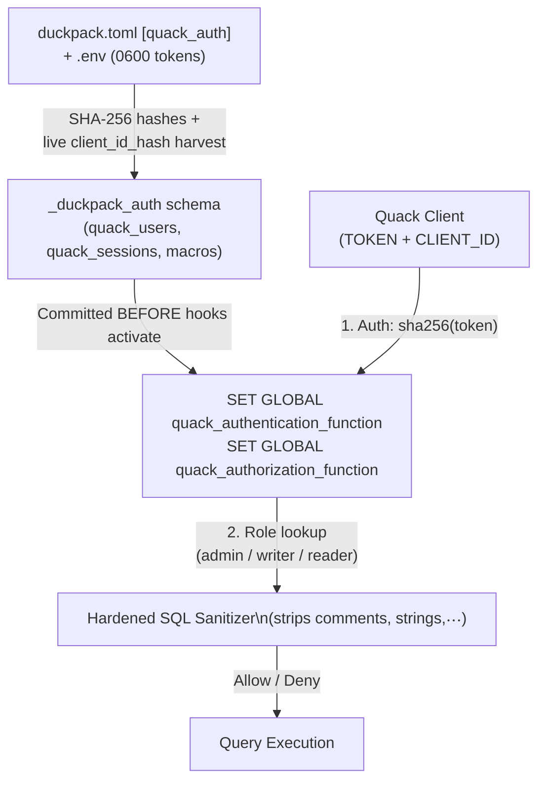

[← Docs Index](./index.md)

# Quack Remote Server & Declarative RBAC

DuckPack provides first-class integration with remote DuckDB v2.0 servers running the **Quack** protocol — including dual-catalog exploration, federated cross-database joins, server-side query routing, declarative Role-Based Access Control (`[quack_auth]`), an interactive Live Session Monitor (`Ctrl+U`), and container restart recovery (`--rbac-only`).

---

## Connecting to a Remote Quack Server

Store your token in `.env` (`QUACK_TOKEN=...`) rather than passing it in shell history:

```bash
# Connect via CLI (loads QUACK_TOKEN from .env automatically)
duckpack explore --db quack:analytics.company.com:443

# Local or internal non-TLS server
duckpack explore --db quack:10.0.0.5:9494 --insecure

# Or use a named profile from duckpack.toml
duckpack explore --env prod
```

### Dual-Catalog Session & Federated Joins

When connected to a remote Quack server, DuckPack keeps **both** catalogs attached simultaneously (with `SET search_path = 'target_db.main,main'`):
1. **`target_db [Active] (quack)`** — your remote Quack server database.
2. **`memory (duckdb)`** — a fast local in-memory scratchpad for temp tables, CSVs, and ad-hoc lookups.

You can join remote and local datasets in a single SQL statement:

```sql
SELECT
    ro.order_id,
    ro.amount,
    lu.customer_segment
FROM target_db.orders ro
JOIN memory.local_segments lu ON ro.customer_id = lu.customer_id
LIMIT 100;
```

### Auto-Routing & The `-- @remote` Directive

- **Automatically pushed to the remote server (`target_db.query(...)`):** DDL (`CREATE TABLE`, `CREATE VIEW`, `CREATE SECURE VIEW`, `CREATE SCHEMA`, `CREATE TRIGGER`, `DROP`, `ALTER`), mutating CTEs, and Quack server functions (`quack_active_connections()`, `quack_server_list()`, `whoami()`, `duckdb_logs_parsed('quack')`).
- **Local by default (prefix with `-- @remote` to run on the server):** Session-scoped commands (`CREATE SECRET`, `SET`, `INSTALL`, `LOAD`).

```sql
-- @remote
CREATE OR REPLACE SECRET prod_s3 (
    TYPE S3,
    KEY_ID '...',
    SECRET '...',
    REGION 'eu-west-1'
);
```

### SSL / Non-TLS Behavior

- `localhost`, `127.0.0.1`, `[::1]`, and `0.0.0.0` automatically disable TLS (`DISABLE_SSL true`).
- For internal IPs or Docker hostnames without TLS, pass `--insecure` (`--quack-disable-ssl`), set `insecure = true` in `duckpack.toml`, or set `DUCKDB_QUACK_DISABLE_SSL=true`.

---

## Declarative Quack RBAC (`[quack_auth]`)

DuckPack implements declarative **Role-Based Access Control** (`admin`, `writer`, `reader`, `none`) directly inside your Quack server using DuckDB v2.0's `quack_authentication_function` and `quack_authorization_function` hooks — with **zero cleartext tokens stored on the server or in `duckpack.toml`**.



### 1. Declare Users & Roles in `duckpack.toml`

```toml
[quack_auth]
enabled = true
ducklake_mode = false                # Set true when Quack hosts a DuckLake metadata catalog
default_role = "reader"              # "admin" | "writer" | "reader" | "none"
writer_allow_temp_tables = true
reader_allow_explain_describe = true
allow_copy = false

[[quack_auth.users]]
username = "alice"
role = "admin"
token_env = "QUACK_USER_ALICE_TOKEN"

[[quack_auth.users]]
username = "dbt_runner"
role = "writer"
token_env = "QUACK_USER_DBT_TOKEN"

[[quack_auth.users]]
username = "bi_reader"
role = "reader"
token_env = "QUACK_USER_BI_TOKEN"
```

> **Security Note (Token-Bound `CLIENT_ID`)**: Leave `client_id` omitted in `[[quack_auth.users]]` so each user's `CLIENT_ID` binds automatically to their 256-bit secret `token_env`. Plaintext `client_id` values in `duckpack.toml` are rejected by default (preventing role spoofing across authenticated sessions) unless `allow_insecure_client_id = true` is explicitly set for legacy isolated setups.

Store tokens in `.env` (`chmod 0600`):

```bash
QUACK_TOKEN=<master_server_token>
QUACK_USER_ALICE_TOKEN=<64_hex_char_token>
QUACK_USER_DBT_TOKEN=<64_hex_char_token>
QUACK_USER_BI_TOKEN=<64_hex_char_token>
```

### 2. Role Permissions Matrix

| Operation | `admin` | `writer` | `reader` |
| :--- | :---: | :---: | :---: |
| `SELECT` / `FROM` / `VALUES` / `SHOW` / `SUMMARIZE` | ✅ | ✅ | ✅ |
| `EXPLAIN` / `DESCRIBE` | ✅ | ✅ | Configurable (`reader_allow_explain_describe`) |
| `INSERT` / `UPDATE` / `DELETE` / `MERGE` | ✅ | ✅ | ❌ |
| `CREATE TEMP TABLE` / `CREATE TEMP VIEW` | ✅ | Configurable (`writer_allow_temp_tables`) | ❌ |
| `CREATE` / `ALTER` / `DROP` (permanent objects) | ✅ | ❌ | ❌ |
| `COPY` | ✅ | Configurable (`allow_copy`) | Configurable (`allow_copy`) |
| `_duckpack_auth.*`, `SET`/`RESET`, `PRAGMA`, `getenv()`, `duckdb_secrets()`, `read_text()`/`glob()`, `CHECKPOINT`, `ATTACH`, `DETACH`, `CALL`, `quack_*` | ✅ | ❌ | ❌ |
| Multi-statement piggybacking (`SELECT 1; DROP TABLE ...`) | ✅ | ❌ | ❌ |

The authorization macro uses a **single-pass recursive SQL lexer** (`_duckpack_auth.sanitize_sql`) matching DuckDB v2.0 lexical precedence — neutralizing `'...'`, `e'...'`/`E'...'`, tagged/untagged `$tag$...$tag$` dollar-quoted strings, double-quoted identifiers (`"..."`), `--` line comments, and depth-counted nested `/* ... */` block comments, and **failing closed** on unclosed tokens or comments.

### 3. DuckLake-Aware Quack RBAC (`ducklake_mode = true`)

When a Quack server hosts a **DuckLake metadata catalog**, both DuckLake DDL (`CREATE TABLE`, `DROP TABLE`, `ALTER TABLE`) and DuckLake DML (`INSERT`, `UPDATE`, `DELETE`) arrive at the Quack server as SQL DML against `ducklake_*` tables.

Enable `ducklake_mode = true` under `[quack_auth]` to separate DuckLake schema DDL from data DML cleanly:

- **`admin`**: Full access to all DuckLake metadata tables and `_duckpack_auth`.
- **`writer`**: Allowed data & snapshot DML (`ducklake_snapshot`, `ducklake_snapshot_changes`, `ducklake_data_file`, `ducklake_delete_file`, `ducklake_files_scheduled_for_deletion`, `ducklake_file_column_stats`, `ducklake_file_variant_stats`, `ducklake_file_partition_value`, `ducklake_table_stats`, `ducklake_table_column_stats`, `ducklake_inlined_data_tables`, `ducklake_inlined_data_*`, `ducklake_inlined_delete_*`, including automatic inlined-table creation) and `SELECT` on all metadata tables — **blocked** from mutating catalog DDL metadata tables (`ducklake_schema`, `ducklake_schema_versions`, `ducklake_table`, `ducklake_column`, `ducklake_column_mapping`, `ducklake_name_mapping`, `ducklake_view`, `ducklake_metadata`, `ducklake_partition_*`, `ducklake_sort_*`, `ducklake_macro*`, `ducklake_tag`, `ducklake_column_tag`).
- **`reader`**: Strictly read-only (zero snapshot commits). Pair with read-only S3/R2 IAM credentials on the client for full object-storage defense-in-depth.

Attach per-role DuckLake-on-Quack clients using DuckLake's native typed `META_*` parameters (automatically emitted by DuckPack's `[[attach]]` and `Ctrl+A`):

```sql
ATTACH 'ducklake:quack:sales-meta.internal:9494' AS sales_writer (
    DATA_PATH 's3://warehouse/sales/',
    META_DISABLE_SSL true,
    META_TOKEN '<writer_token>',
    META_CLIENT_ID '<writer_token>'
);
```

### 4. Deploy & Multi-Alias Session Isolation

Running `duckpack apply --env prod --auto-approve`:
1. Hashes each resolved token with **SHA-256** locally (cleartext tokens never reach the server).
2. Harvests each user's live server-salted `client_id_hash` from the running Quack server and binds the deploying master session as `admin`.
3. Commits `_duckpack_auth` tables and hardened authorization macros **before** enabling `SET GLOBAL quack_authentication_function` and `SET GLOBAL quack_authorization_function`.

You can attach multiple role aliases side by side in the same DuckDB / DuckPack session using per-alias token-bound credentials:

```sql
ATTACH 'quack:localhost:9494' AS q_admin  (TOKEN '<alice_token>',  CLIENT_ID '<alice_token>',  DISABLE_SSL true);
ATTACH 'quack:localhost:9494' AS q_reader (TOKEN '<reader_token>', CLIENT_ID '<reader_token>', DISABLE_SSL true);
```

---

## Interactive Session Monitor & User Manager (`Ctrl+U`)

Press **`Ctrl+U`** (or select **`🛡️ Quack RBAC & Sessions (Ctrl+U)`** in Explorer) to open the RBAC control panel:

- **Multi-Server Target Switching (`[` / `]`):** Cycle across all directly attached Quack servers **and** DuckLake-on-Quack catalogs (connecting lazily on demand to each DuckLake's underlying Quack server without cluttering Explorer).
- **Tab 1 — Live Sessions (`quack_active_connections()`):**
  - `c`: Cancel an active query via client-side `quack_cancel(catalog, connection_id)`
  - `x`: Revoke or restore a session immediately (`_duckpack_auth.quack_sessions.revoked`)
  - `r`: Cycle a live session's role override (`admin` / `writer` / `reader`)
  - `u` / `F5`: Refresh active connections
- **Tab 2 — Declarative Users & Roles:**
  - `a`: Add a user (auto-generates a 256-bit cryptographic token into `.env` with `0600` permissions)
  - `Space`: Enable/disable user (protected by the **Admin Lockout Prevention Guard**)
  - `r`: Cycle role (`admin` / `writer` / `reader`)
  - `t`: Rotate 256-bit token in `.env`
  - `Del`: Remove user (protected by Admin Lockout Prevention Guard)
  - `d`: Deploy/sync RBAC immediately (`--rbac-only` equivalent)
  - `e`: Export executable post-start hook (`scripts/quack_rbac_post_start.sh`) and bootstrap SQL (`scripts/quack_rbac_init.sql`)

---

## Container & Server Restarts (`--rbac-only` Post-Start Hook)

Even with a persistent `.duckdb` file on disk, restarting a Quack server resets two in-memory states:
1. `SET GLOBAL quack_authentication_function` and `SET GLOBAL quack_authorization_function`
2. Quack's per-boot random salt used for `quack_active_connections().client_id_hash`

Use **`--rbac-only`** to re-sync **only** `_duckpack_auth` (fresh salted hashes + global hooks) without applying pending user tables, views, or drops:

```bash
duckpack apply --env prod --rbac-only --auto-approve
```

### Portable Zero-Secret RBAC Bundles (`.duckpack`) for Container Fleets

When bootstrapping multiple DuckLake/Quack containers without shipping your project directory or `duckpack.toml` into every image:

1. **Build a zero-secret bundle in CI** (stores policy + `token_env` references only — **never** plaintext tokens or hashes):
   ```bash
   duckpack compile --project-dir ./warehouse --rbac-only --out rbac.duckpack
   ```
2. **Apply at container startup with zero project directory** (resolves tokens from container OS env vars or an optional `--env-file`):
   ```bash
   duckpack apply --from /app/rbac.duckpack --rbac-only --db quack:127.0.0.1:9494 --insecure --auto-approve

   # Or load tokens from a mounted Kubernetes secret file:
   duckpack apply --from /app/rbac.duckpack --rbac-only --env-file /run/secrets/quack.env --db quack:127.0.0.1:9494 --insecure --auto-approve
   ```

The exported `scripts/quack_rbac_post_start.sh` supports both modes automatically: set `DUCKPACK_RBAC_BUNDLE=/app/rbac.duckpack` and `DUCKPACK_QUACK_DB=quack:127.0.0.1:9494` to use bundle mode without any project tree.

Press **`e`** inside `Ctrl+U` to export a ready-to-run `scripts/quack_rbac_post_start.sh` (`chmod 0755`) that waits until Quack is reachable and executes `--rbac-only --auto-approve`.

> **DuckDB v2.0 `quack_serve` Note:** Binding to `0.0.0.0` requires `allow_other_hostname = true`, and running `duckdb` non-interactively in a container requires `-init ... -no-stdin` (or `duckdb <file> -serve`) because `duckdb -c "..."` exits as soon as `quack_serve` returns.

### Docker Entrypoint
```bash
/app/scripts/quack_rbac_post_start.sh &
exec duckdb /data/warehouse.duckdb \
  -init <(printf "LOAD quack; CALL quack_serve('quack:0.0.0.0:9494', token = '%s', disable_ssl = true, allow_other_hostname = true);\n" "${QUACK_MASTER_TOKEN}") \
  -no-stdin
```

### Docker Compose
```yaml
services:
  quack-db:
    image: my-duckdb-quack:latest
    environment:
      DUCKPACK_ENV: prod
      QUACK_MASTER_TOKEN: ${QUACK_MASTER_TOKEN}
    entrypoint:
      - /bin/bash
      - -c
      - |
        /app/scripts/quack_rbac_post_start.sh &
        exec duckdb /data/warehouse.duckdb \
          -init <(printf "LOAD quack; CALL quack_serve('quack:0.0.0.0:9494', token = '%s', disable_ssl = true, allow_other_hostname = true);\n" "$QUACK_MASTER_TOKEN") \
          -no-stdin
```

### Kubernetes `lifecycle.postStart`
```yaml
lifecycle:
  postStart:
    exec:
      command: ["/app/scripts/quack_rbac_post_start.sh"]
```

### systemd (`ExecStartPost`)
```ini
[Service]
ExecStart=/bin/bash -c "/usr/local/bin/duckdb /var/lib/duckdb/warehouse.duckdb -init <(printf \"LOAD quack; CALL quack_serve('quack:0.0.0.0:9494', token = '%s', disable_ssl = true, allow_other_hostname = true);\\n\" \"${QUACK_MASTER_TOKEN}\") -no-stdin"
ExecStartPost=/opt/my_project/scripts/quack_rbac_post_start.sh
```
